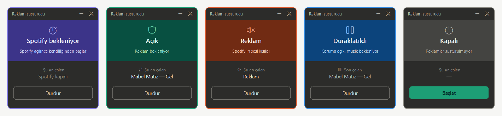

# Silencify: Details

**English** | [Türkçe](DETAYLAR.md)

A small Windows app that **automatically mutes Spotify** when an ad plays and unmutes it when the ad ends.

> ⚠️ **It does not block ads!** The ad still plays, you just don't hear it. It never touches Spotify itself, your account or your internet connection.



*The app's interface is currently in Turkish.*

## Features

- **Only Spotify is muted.** Other sounds on your computer (YouTube, Discord, games...) are not affected.
- **Your volume level is left alone.** Spotify is muted/unmuted with the "mute" switch, so after the ad you continue at the same volume.
- **Recognizes podcasts** and does not mute them.
- **You have the final say.** If you muted Spotify yourself, the app leaves it alone. If you unmute during an ad, it won't mute again for that ad break.
- **Sound never stays muted.** Even if the app closes unexpectedly (crash, shutdown), it unmutes Spotify on the next start.
- **A calm tray icon next to the clock:** green = running, purple = waiting for Spotify, gray = stopped.
- **Optionally starts with Windows** and quietly waits until Spotify is opened.
- **Language independent:** recognizes ads in Turkish, English or any other language.
- **Lightweight:** ~40 MB of memory, almost zero CPU usage.

## How does it work?

Once per second the app looks at Spotify and reads two things:
1. **The title of the Spotify window** (shows `Artist - Song` while a song is playing)
2. **Windows' media information** (the song and artist shown in the box that appears when you press the media keys)

Then it asks these questions **in order** and decides at the first "yes":

| Step | Question | Decision |
|---|---|---|
| 1 | Is the title "Spotify Free / Premium"? | Paused |
| 2 | Does the media info say it's an ad? (artist is "Spotify" or a known ad text) | Ad |
| 3 | Is the artist empty? | Podcast |
| 4 | Is the title in the `Artist - Song` format? | Song |
| 5 | None of the above | Ad |

The rule was tested with examples collected from real listening logs (`testler/test_kural.py`).

## Installation

1. Download `Silencify.exe` from the [Releases](../../../releases) page.
2. Double-click it. That's it.

No installer, no Python or other programs needed. (Windows 10/11)

> **If you see "Windows protected your PC":** click **More info → Run anyway**.
> This warning appears for every small, independent program without a digital signature
> (code signing certificate); it does not mean the program is harmful. All of the code is public on this page.
>
> The first start may take a few seconds: the single-file program unpacks itself while starting.

Settings and logs are stored in: `%LOCALAPPDATA%\Silencify`
To uninstall, just delete the `.exe` and this folder (if you enabled "start with Windows", turn it off from the menu first).

## Usage

- **×** button: asks whether to "keep running in the background" or "close the app completely".
- **Right-click the icon next to the clock:** Start/Stop, start automatically on launch, start with Windows.
- Only one copy of the app can run at a time.

## Project structure

| File | Purpose |
|---|---|
| `silencify/uygulama.py` | Launcher of the windowed version: window + engine + tray icon |
| `silencify/reklam_susturucu.py` | Launcher of the terminal version |
| `silencify/motor.py` | The brain of the app: look, decide, mute/unmute |
| `silencify/kural.py` | The "what is playing right now?" decision |
| `silencify/spotify.py` | Everything that talks to Spotify and Windows |
| `silencify/arayuz.py` | The window and dialogs |
| `silencify/simge.py` | The app icon (easy to replace, see `silencify/simgeler/`) |
| `silencify/kayit.py`, `yollar.py`, `ayarlar.py` | Logging, file paths, user preferences |
| `silencify/baslangic.py`, `tek_kopya.py` | Start with Windows, single-instance protection |
| `testler/` | Automated tests |
| `araclar/` | Observation and measurement tools used during development |

## Tests

```bash
python testler/test_kural.py      # Ad detection rule (real cases)
python testler/test_senaryo.py    # Engine behaviour (with a fake Spotify)
```

## Status

**v1.0.0**: Ad detection, muting, interface and start with Windows are working.

**Known limitation:** Spotify's main window is found as "the largest window"; if the mini player is made larger than the main window, the app may get confused.

## License

[MIT](../LICENSE): You are free to use, modify and share it.
