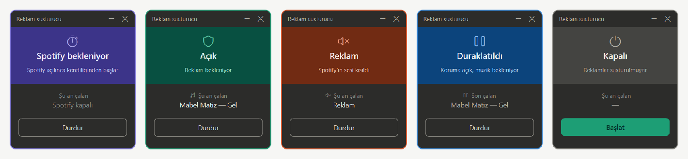

# Silencify: Detaylar

[English](DETAILS.md) | **Türkçe**

Spotify'da reklam çaldığında **Spotify'ın sesini otomatik olarak kısan**, reklam bitince geri açan küçük bir Windows uygulaması.

> ⚠️ **Reklamı engellemez!** Reklam yine çalar, sadece sesi duyulmaz. Spotify'ın kendisine, hesabına ya da internet bağlantına hiçbir şekilde dokunmaz.



## Özellikler

-  **Sadece Spotify'ın sesi kısılır.** Bilgisayarın geri kalan sesleri (YouTube, Discord, oyun...) etkilenmez.
-  **Ses seviyene dokunmaz.** Spotify'ı "sessiz" düğmesiyle kapatıp açar, reklamdan sonra aynı seviyeden devam edersin.
-  **Podcast'leri tanır**, podcast'lerde sesi kısmaz.
-  **Son söz senin.** Spotify'ı kendin sessize aldıysan program dokunmaz. Reklam sırasında sesi kendin açarsan o reklam arası boyunca tekrar kısmaz.
-  **Ses kapalı kalmaz.** Program beklenmedik şekilde kapansa bile (çökme, bilgisayarın kapanması) bir sonraki açılışta kıstığı sesi geri açar.
-  **Saatin yanında sakin bir simge:** yeşil = çalışıyor, mor = Spotify bekleniyor, gri = durduruldu.
-  **İstersen Windows açılınca başlar**, Spotify açılana kadar sessizce bekler.
-  **Dilden bağımsız:** Türkçe, İngilizce ya da başka dildeki reklamları tanır.
-  **Hafif:** ~40 MB bellek, neredeyse sıfır işlemci kullanımı.

## Nasıl çalışır?

Program saniyede bir Spotify'a bakar ve iki bilgiyi okur:
1. **Spotify penceresinin başlığı** (şarkı çalarken `Sanatçı - Şarkı` yazar)
2. **Windows'un medya bilgisi** (ses tuşlarına basınca çıkan kutucuktaki şarkı ve sanatçı)

Sonra şu soruları **sırayla** sorar, ilk "evet"te karar verir:

| Sıra | Soru | Karar |
|---|---|---|
| 1 | Başlık "Spotify Free / Premium" mu? |  Duraklatıldı |
| 2 | Medya bilgisi reklam diyor mu? (sanatçı "Spotify" ya da bilinen bir reklam metni) |  Reklam |
| 3 | Sanatçı boş mu? |  Podcast |
| 4 | Başlık "Sanatçı - Şarkı" biçiminde mi? |  Şarkı |
| 5 | Hiçbiri değil |  Reklam |

Kural, gerçek dinleme kayıtlarından toplanan örneklerle test edildi (`testler/test_kural.py`).

## Kurulum

1. [Releases](../../../releases) sayfasından `Silencify.exe` dosyasını indir.
2. Çift tıkla. Bu kadar. 

Kurulum sihirbazı yok, Python ya da başka bir program gerekmez. (Windows 10/11)

> **"Windows bilgisayarınızı korudu" uyarısı çıkarsa:** **Ek bilgi → Yine de çalıştır**'a bas.
> Bu uyarı, dijital imzası (code signing sertifikası) olmayan bütün küçük, bağımsız programlarda çıkar;
> programın zararlı olduğu anlamına gelmez. Kodun tamamı bu sayfada açık, istersen inceleyebilirsin.
>
> İlk açılış birkaç saniye sürebilir: tek dosyalık program açılırken kendini hazırlar.

Ayarların ve kayıtların yeri: `%LOCALAPPDATA%\Silencify`
Programı kaldırmak için `.exe`'yi ve bu klasörü silmen yeterli (Windows açılınca başlatmayı açtıysan önce menüden kapat).

## Kullanım

- **×** düğmesi: "Arka planda çalışsın" ya da "Uygulama tamamen kapansın" seçeneklerini sorar.
- **Saatin yanındaki simgeye sağ tık:** Başlat/Durdur, açılışta otomatik başlatma, Windows açılınca başlatma.
- Program aynı anda yalnızca bir kez çalışabilir.
- **Dil:** Pencerenin üst köşesindeki **TR / EN** düğmesi ya da menüdeki **Dil / Language** ile Türkçe ve İngilizce arasında geçilir. İlk açılışta Windows'un dili kullanılır.

## Proje yapısı

| Dosya | Görevi |
|---|---|
| `silencify/uygulama.py` | Pencereli sürümün başlatıcısı: pencere + motor + tepsi simgesi |
| `silencify/reklam_susturucu.py` | Terminal sürümünün başlatıcısı |
| `silencify/motor.py` | Programın beyni: bak, karar ver, sesi kıs/aç |
| `silencify/kural.py` | "Şu an ne çalıyor?" kararı |
| `silencify/spotify.py` | Spotify ve Windows ile konuşan her şey |
| `silencify/arayuz.py` | Pencere ve soru pencereleri |
| `silencify/dil.py` | Uygulamanın bütün yazıları (Türkçe ve İngilizce) |
| `silencify/simge.py` | Programın simgesi (kolay değiştirilebilir, bkz. `silencify/simgeler/`) |
| `silencify/kayit.py`, `yollar.py`, `ayarlar.py` | Kayıt tutma, dosya yolları, kullanıcı tercihleri |
| `silencify/baslangic.py`, `tek_kopya.py` | Windows açılınca başlatma, tek kopya koruması |
| `testler/` | Otomatik testler |
| `araclar/` | Geliştirme sırasında kullanılan gözlem ve ölçüm araçları |

## Testler

```bash
python testler/test_kural.py      # Reklam tanıma kuralı (gerçek vakalar)
python testler/test_senaryo.py    # Motorun davranışı (sahte bir Spotify ile)
python testler/test_dil.py        # İki dilde de bütün yazılar var mı
```

## Durum

**v1.1.0**: Reklam tanıma, ses kısma, arayüz ve Windows ile başlama çalışıyor. Uygulama Türkçe ya da İngilizce kullanılabiliyor.

**Bilinen eksik:** Spotify'ın ana penceresi "en büyük pencere" olarak bulunuyor; mini oynatıcı ana pencereden büyük yapılırsa program şaşırabilir.

## Lisans

[MIT](../LICENSE): Dilediğin gibi kullanabilir, değiştirebilir, paylaşabilirsin.
